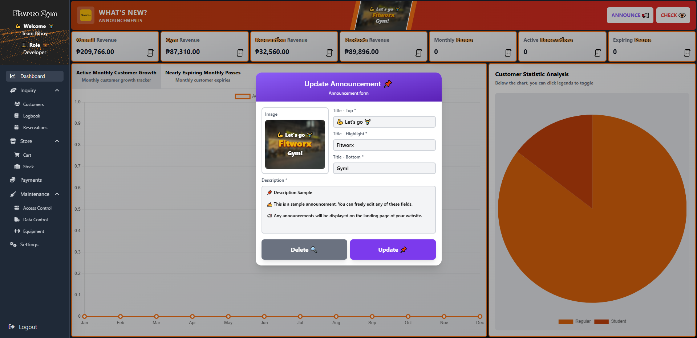
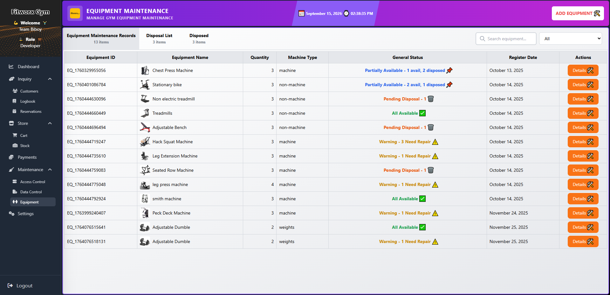
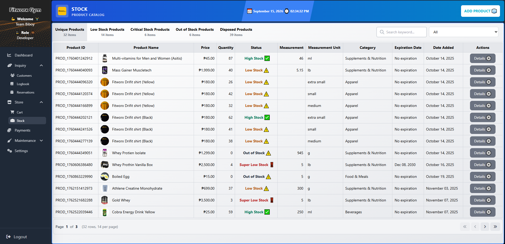
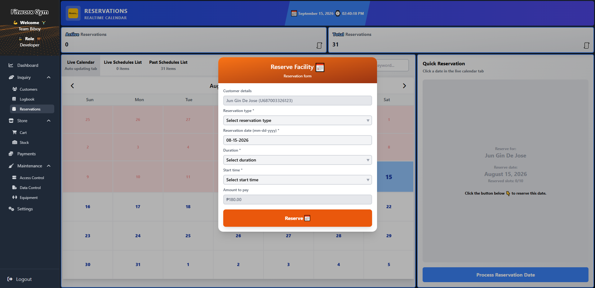
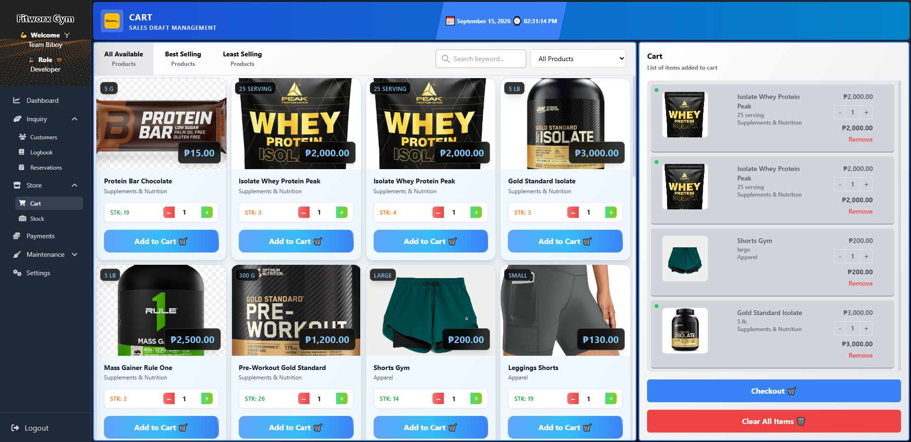
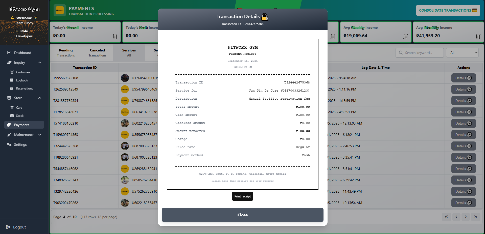
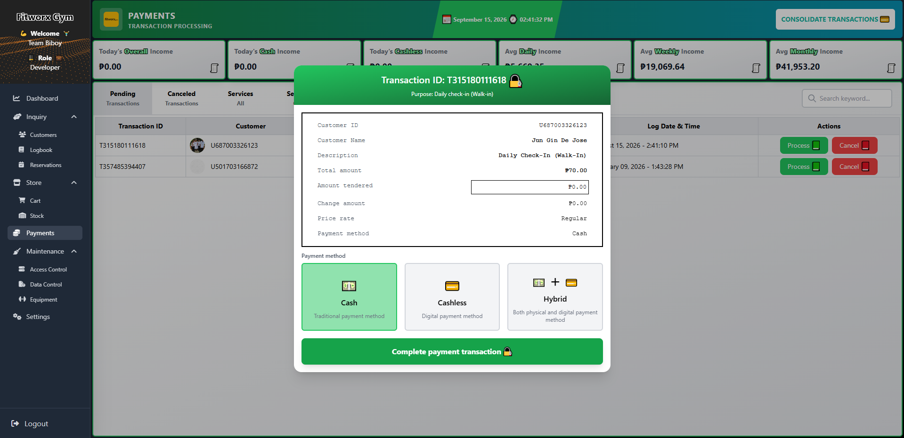

# Online Gym Facility Management with Sales and Inventory (OGFMSI)

**OGFMSI** is a comprehensive web application developed for [**Fitworx Gym**](https://fitworxgymph.web.app/). The system is designed to replace manual gym management processes with a centralized digital platform for managing gym operations, sales, inventory, equipment, reservations, and transactions.

## 👥 Developed By

This project was proudly developed by the following hardworking students of **STI College Fairview**, under the guidance, support, and mentorship of their dedicated adviser.

| Team Member | Role |
|---|---|
| **Enzo P. Daniela** | Chief Executive Officer (CEO) / Project Leader / Backend Developer |
| **Jun Gin Xenon M. De Jose** | Chief Technology Officer (CTO) / Business Analyst / Quality Assurance |
| **Kyan Ray I. Villarin** | Systems Analyst / UI/UX Designer / Frontend Developer |
| **Jestley Charles R. Estipona** | DevOps / Cloud Engineer / Full-Stack Developer |

**Adviser:**  
- **Rubinato "Flux" Lubian III**

---

## 📸 Quick Tour

### Dashboard



### Equipment Management



### Stock Management



### Reservations



### Shopping Cart



### Payment Details



### Payment Transaction



> All screenshots are available in the project's [`screenshots`](https://github.com/jestleycharles/ogfmsi/tree/main/screenshots) directory.

---

## ✨ Features

* **Dashboard** — Overview of gym operations and key information.
* **Equipment Management** — Monitor and manage gym equipment.
* **Inventory & Stock Management** — Track available products and stock levels.
* **Reservations** — Manage gym-related reservations.
* **Shopping Cart** — Add and manage items before checkout.
* **Payments** — Handle payment details and transaction records.
* **Administrative Management** — Provide administrative interfaces for managing the system.
* **Responsive UI** — Designed for use across different screen sizes.
* **Firebase Hosting** — Frontend deployment through Firebase Hosting.
* **REST API Backend** — Backend services powered by Node.js and Express.
* **Database Integration** — Backend support for MySQL-based data management.

---

## 🛠️ Tech Stack

| Technology             | Purpose                                         |
| ---------------------- | ----------------------------------------------- |
| **HTML5**              | Application structure and pages                 |
| **Tailwind CSS**       | UI styling and responsive design                |
| **Vanilla JavaScript** | Frontend interactivity and application logic    |
| **Node.js**            | Backend runtime                                 |
| **Express.js**         | REST API and backend server                     |
| **MySQL**              | Database management                             |
| **Firebase**           | Frontend hosting and Firebase Admin integration |
| **Render**             | Backend web-service deployment                  |

### Frontend

The frontend uses semantic **HTML**, **Tailwind CSS**, and **Vanilla JavaScript** to provide the application's user interface and client-side functionality.

### Backend

The backend is a separate Node.js/Express application located in the `backend/` directory. It provides API functionality and integrates with MySQL and Firebase Admin. The backend package includes scripts for starting the server, development with Nodemon, and database migrations.

### Deployment

The project uses:

* **Firebase Hosting** for the frontend.
* **Render Web Service** for the Node.js/Express backend.

Firebase Hosting is configured with routes including `/admin`, `/login`, `/dashboard`, `/about`, `/privacy`, and `/terms`.

---

## 📁 Project Structure

```text
ogfmsi/
├── backend/
│   ├── database/
│   ├── server.js
│   ├── package.json
│   └── ...
│
├── screenshots/
│   ├── cart.png
│   ├── dashboard.png
│   ├── equipment.png
│   ├── payment_details.png
│   ├── payment_transaction.png
│   ├── reservations.png
│   └── stock.png
│
├── src/
│   ├── css/
│   ├── html/
│   └── js/
│
├── .github/
├── firebase.json
├── index.html
├── package.json
├── tailwind.config.js
└── README.md
```

---

## 🚀 Getting Started

### Prerequisites

Make sure you have the following installed:

* [Node.js](https://nodejs.org/)
* npm
* Git
* MySQL

### 1. Clone the repository

```bash
git clone https://github.com/jestleycharles/ogfmsi.git
cd ogfmsi
```

### 2. Install frontend dependencies

```bash
npm install
```

### 3. Build Tailwind CSS

```bash
npm run build
```

This compiles the Tailwind input stylesheet into the project's generated CSS output.

### 4. Install backend dependencies

```bash
cd backend
npm install
```

### 5. Configure environment variables

Create a `.env` file inside the `backend/` directory and configure the required database and Firebase credentials.

Example:

```env
PORT=3000

DB_HOST=your_database_host
DB_USER=your_database_user
DB_PASSWORD=your_database_password
DB_NAME=your_database_name
DB_PORT=3306

# Add Firebase configuration required by the backend
```

> Do not commit `.env` files, database credentials, Firebase private keys, or other secrets to the repository.

### 6. Run the backend

For development:

```bash
npm run dev
```

Or start the production server:

```bash
npm start
```

The backend uses Express and starts from `backend/server.js`.

---

## 🌐 Deployment

### Frontend — Firebase Hosting

The project includes a `firebase.json` configuration for Firebase Hosting.

After installing the Firebase CLI and authenticating with your Firebase account, deploy the frontend with:

```bash
firebase deploy --only hosting
```

The current Firebase Hosting configuration uses the `fitworxgymph` hosting site.

### Backend — Render

The backend can be deployed as a **Render Web Service**.

Recommended configuration:

```text
Root Directory: backend
Build Command: npm install
Start Command: npm start
```

Configure the required environment variables in the Render dashboard rather than committing credentials to the repository.

---

## 🗄️ Database

The backend uses **MySQL** through the `mysql2` package.

Database-related functionality is located under:

```text
backend/database/
```

Database migrations can be executed with:

```bash
npm run migrate
```

---

## 🔀 Git Workflow

For contributors, create a separate branch before making changes:

```bash
git checkout -b your-branch-name
```

Install the project dependencies:

```bash
npm install
```

Make your changes, then commit them using clear commit messages:

```bash
git add .
git commit -m "Feat: Add new feature"
git push origin your-branch-name
```

### Commit Convention

Use:

* `Feat:` for new functionality
* `Fix:` for bug fixes

Examples:

```text
Feat: Add equipment management
Fix: Correct dashboard layout on mobile
```

### Keeping Your Branch Updated

```bash
git stash
git checkout main
git pull origin main
git checkout your-branch-name
git merge main
git stash pop
```

---

## 📌 Project Status

OGFMSI is an actively developed gym facility management system for **Fitworx Gym**. Its goal is to centralize day-to-day gym operations and provide staff and administrators with a more efficient alternative to manual processes.

---

## 👥 Contributors

This project is maintained by the OGFMSI development team.

For contributions, improvements, or bug reports, please use the repository's GitHub Issues and Pull Requests.

---

## 📄 License

This project currently uses the license configuration specified in its repository metadata.
